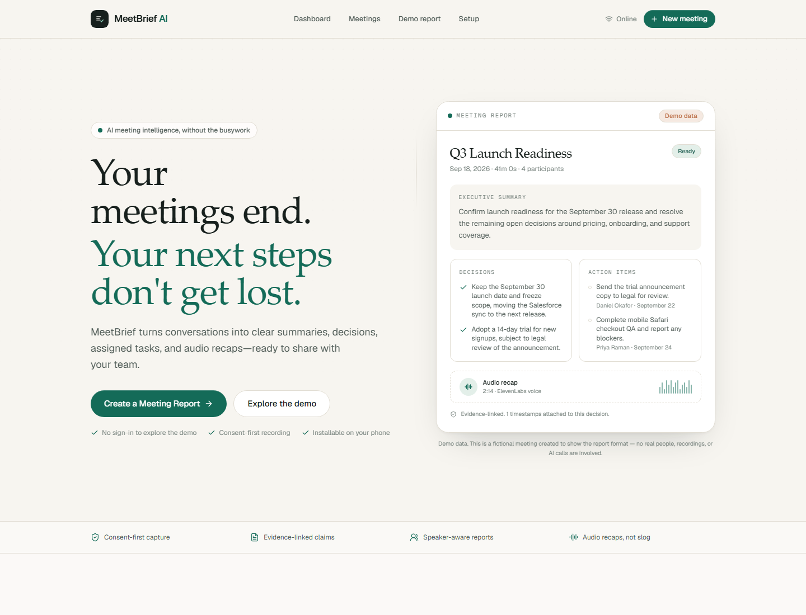
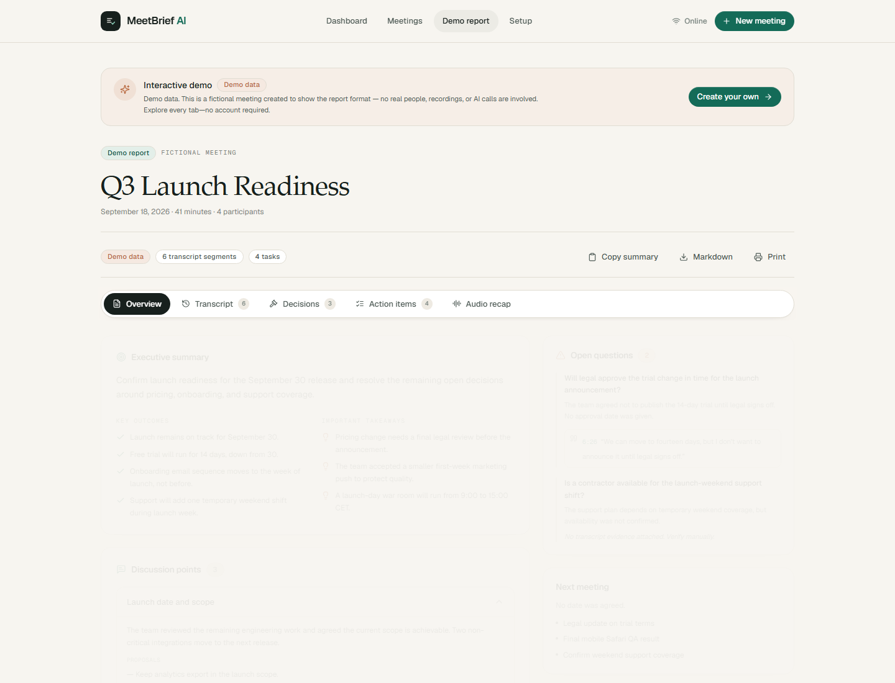
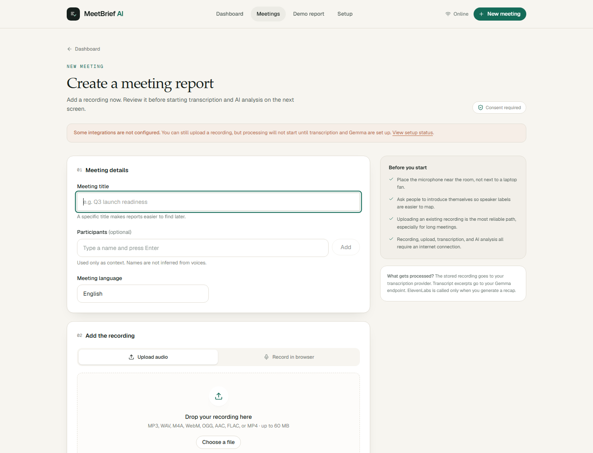
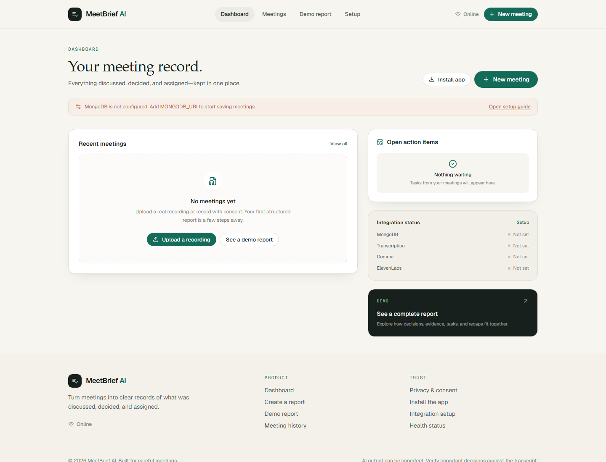
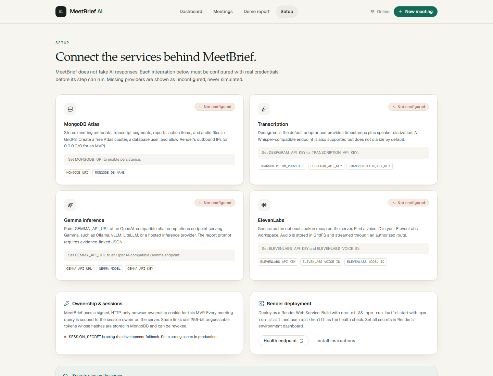
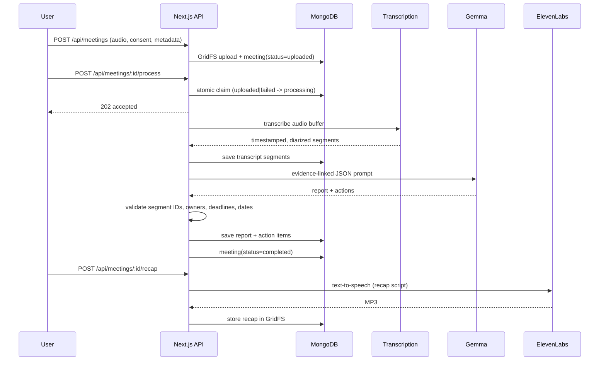

# MeetBrief AI

**Meetings end. Next steps don't get lost.**

MeetBrief AI turns a meeting recording into a transcript, an evidence-linked report, assigned action items, and an optional spoken recap. It is a Next.js App Router PWA backed by MongoDB Atlas, with real transcription, Gemma, and ElevenLabs integrations — no simulated AI responses.



## Contents

- [What it does](#what-it-does)
- [Screenshots](#screenshots)
- [Stack](#stack)
- [Architecture](#architecture)
- [Processing pipeline](#processing-pipeline)
- [Quick start](#quick-start)
- [Provider setup](#provider-setup)
- [Environment variables](#environment-variables)
- [Data model and retention](#data-model-and-retention)
- [Security and privacy](#security-and-privacy)
- [PWA and offline behavior](#pwa-and-offline-behavior)
- [Deploy to Render](#deploy-to-render)
- [Demo workflow](#demo-workflow)
- [Testing](#testing)
- [Troubleshooting](#troubleshooting)
- [Known limitations](#known-limitations)
- [Project structure](#project-structure)

## What it does

- **Upload or record** a meeting with explicit participant-consent confirmation.
- **Transcribe** with timestamps and speaker diarization (Deepgram `nova-3` by default; an OpenAI-compatible Whisper endpoint is also supported).
- **Generate a structured Gemma report**: purpose, key outcomes, takeaways, discussion points, decisions, owners, deadlines, open questions, and next-meeting agenda.
- **Verify evidence**: model claims are checked against transcript segment IDs. Unsupported decisions, owners, deadlines, and dates are removed or rewritten, and warnings are shown in the report.
- **Edit safely**: summary, decisions, transcript text, speaker mapping, and action items can be corrected by the owner.
- **Create an audio recap** with ElevenLabs from a deterministic script built from the edited report.
- **Share with control**: read-only share links use 256-bit tokens; only the SHA-256 hash is stored, and links can be revoked.
- **Export**: copy the summary, download Markdown, or print the report.
- **Install as a PWA** with an offline fallback page.
- **Demo without an account**: `/demo` shows a complete fictional report, clearly labeled as demo data.

### Screenshots

| Report workspace | New meeting |
| --- | --- |
|  |  |

| Dashboard | Setup status |
| --- | --- |
|  |  |

> Screenshots were captured from the local app with integrations intentionally unconfigured. The demo report is fictional; no real recording, transcript, or AI request is shown.

## Stack

| Layer | Choice |
| --- | --- |
| Framework | Next.js 15 App Router, React 19, TypeScript |
| Styling | Tailwind CSS 4, Geist Sans/Mono, custom warm-neutral design tokens |
| Database | MongoDB Atlas (metadata, reports, actions, share hashes) |
| File storage | MongoDB GridFS bucket `meeting_files` for recordings and audio recaps |
| Transcription | Deepgram `nova-3` with diarization, or OpenAI-compatible Whisper |
| Analysis | Gemma served through an OpenAI-compatible `/chat/completions` endpoint |
| Audio recap | ElevenLabs text-to-speech |
| Auth | Signed, HTTP-only browser ownership cookie for the MVP |
| Deploy | Render Web Service |

## Architecture

```mermaid
flowchart LR
    subgraph Browser
        UI[Next.js App Router UI]
        Rec[MediaRecorder]
        SW[Service worker / offline fallback]
    end

    subgraph Render["Render Web Service (Node)"]
        API[Route handlers + server actions]
        MW[Middleware: signed ownership cookie]
        Job[after() processing job]
        Auth[Owner / share-token checks]
    end

    subgraph Atlas["MongoDB Atlas"]
        Meta[(meetings)]
        Seg[(transcript_segments)]
        Rep[(reports)]
        Act[(action_items)]
        Grid[(GridFS: meeting_files)]
    end

    DG[Deepgram / Whisper]
    Gemma[Gemma endpoint]
    EL[ElevenLabs]

    UI -->|upload + consent| API
    Rec -->|browser audio| UI
    API --> MW --> Auth
    Auth --> Meta
    Auth --> Seg
    Auth --> Rep
    Auth --> Act
    API -->|audio buffer| Grid
    API -->|claim job| Job
    Job -->|download audio| Grid
    Job -->|transcribe| DG
    Job -->|segments + prompt| Gemma
    Job -->|validated report| Rep
    Job -->|action items| Act
    Job -->|recap script| EL
    EL -->|MP3| Grid
    API -->|authorized stream| UI
    SW -. caches shell only .-> UI
```

### Request and ownership model

1. Middleware issues a signed `mb_session` cookie whose value is an opaque owner ID plus an HMAC signature.
2. Every meeting mutation and read is scoped by `userId` on the server; a meeting ID alone is never sufficient.
3. Share pages are read-only, noindex, and resolve by hashing the URL token and matching the stored hash.
4. Provider keys live only in server-only modules and are never sent to the browser or service worker.

## Processing pipeline



Statuses: `uploaded → processing (queued, transcribing, analyzing, saving) → completed | failed`.

Processing is started with Next.js `after()` so the HTTP request returns quickly. The status endpoint is polled by the meeting page. Cancellation sets a flag and a failed state; a retry is available from the UI. The atomic claim prevents two tabs from processing the same meeting at once.

## Quick start

### Prerequisites

- Node.js 20 or newer (Node 22 is used on Render)
- A MongoDB Atlas cluster (or another MongoDB deployment)
- A Deepgram API key (default), or an OpenAI-compatible Whisper endpoint
- A Gemma endpoint exposing an OpenAI-compatible chat completions API
- An ElevenLabs API key and voice ID (only needed for audio recaps)

### Local setup

```bash
npm install
cp .env.example .env.local
# Fill in MONGODB_URI, SESSION_SECRET, and provider credentials
npm run dev
```

Open `http://localhost:3000`. The dashboard and `/setup` page show exactly which integrations are configured. Missing credentials are reported as unconfigured; the app does not fabricate successful responses.

Useful commands:

```bash
npm run dev        # development server
npm run typecheck  # TypeScript
npm test           # Vitest unit tests
npm run build      # production build
npm run start      # production server (PORT defaults to 3000)
```

### Minimal configuration for the demo

No credentials are needed to view `/demo`, `/install`, `/privacy`, `/offline`, or the landing page. MongoDB is required to create or list real meetings; transcription and Gemma are required before processing can start.

## Provider setup

### MongoDB Atlas

1. Create a free Atlas cluster and a database user.
2. Add a network access rule. For a quick MVP, `0.0.0.0/0` works; for production, restrict it to Render's outbound IPs where possible.
3. Copy the driver connection string into `MONGODB_URI`.
4. Keep `MONGODB_DB_NAME=meetbrief` unless you need a different database.

Indexes are created lazily on first database use. The GridFS bucket is named `meeting_files`; MIME types are stored in GridFS metadata (`metadata.contentType`) because MongoDB v7 GridFS no longer has a top-level `contentType` field.

### Transcription

**Deepgram (recommended):**

```dotenv
TRANSCRIPTION_PROVIDER=deepgram
DEEPGRAM_API_KEY=...
DEEPGRAM_MODEL=nova-3
```

Deepgram returns timestamps and diarized speaker labels. Speaker labels are anonymous (`speaker_0`, etc.) until a user maps them on the transcript tab.

**Whisper-compatible endpoint:**

```dotenv
TRANSCRIPTION_PROVIDER=whisper
TRANSCRIPTION_API_URL=https://api.openai.com/v1
TRANSCRIPTION_API_KEY=...
TRANSCRIPTION_MODEL=whisper-1
```

The Whisper adapter is for OpenAI-compatible `/audio/transcriptions` APIs. It does not provide diarization by default.

### Gemma

MeetBrief expects an OpenAI-compatible chat completions endpoint. Point `GEMMA_API_URL` at either the base URL or the full `/chat/completions` URL.

Ollama example:

```bash
ollama pull gemma3:27b
ollama serve
```

```dotenv
GEMMA_API_URL=http://localhost:11434/v1
GEMMA_MODEL=gemma3:27b
GEMMA_API_KEY=
GEMMA_TIMEOUT_MS=180000
```

vLLM, LiteLLM, and hosted OpenAI-compatible inference providers work as well. `GEMMA_API_URL` must be reachable **from the Render server**, so an Ollama instance on your laptop is not reachable from Render without a tunnel or public endpoint.

The prompt asks for JSON with evidence segment IDs. The server validates the response with Zod and reconciles claims against the transcript before saving. It does not trust the model's owners, deadlines, or dates blindly.

### ElevenLabs

```dotenv
ELEVENLABS_API_KEY=...
ELEVENLABS_VOICE_ID=...
ELEVENLABS_MODEL_ID=eleven_multilingual_v2
```

Find a voice ID in the ElevenLabs workspace. Recap audio is generated on demand, stored in GridFS, and streamed through an owner-authorized route. The script is saved even if TTS fails so it can be reviewed or retried.

## Environment variables

| Variable | Required | Purpose |
| --- | --- | --- |
| `MONGODB_URI` | Yes for real meetings | Atlas connection string |
| `MONGODB_DB_NAME` | No | Database name (default `meetbrief`) |
| `SESSION_SECRET` | Yes in production | HMAC key for the ownership cookie; 32+ random characters |
| `NEXT_PUBLIC_APP_URL` | Recommended | Public origin used to build share links, no trailing slash |
| `TRANSCRIPTION_PROVIDER` | No | `deepgram` (default) or `whisper` |
| `DEEPGRAM_API_KEY` | Deepgram | Deepgram API key |
| `DEEPGRAM_MODEL` | No | Default `nova-3` |
| `TRANSCRIPTION_API_URL` | Whisper | OpenAI-compatible base URL |
| `TRANSCRIPTION_API_KEY` | Whisper | Whisper/OpenAI-compatible key |
| `TRANSCRIPTION_MODEL` | No | Default `whisper-1` |
| `GEMMA_API_URL` | Yes for processing | OpenAI-compatible Gemma endpoint |
| `GEMMA_API_KEY` | Depends | Bearer token if the endpoint requires one |
| `GEMMA_MODEL` | No | Default `gemma3:27b` |
| `GEMMA_TIMEOUT_MS` | No | 10s–600s; default 180s |
| `ELEVENLABS_API_KEY` | For recaps | ElevenLabs API key |
| `ELEVENLABS_VOICE_ID` | For recaps | ElevenLabs voice |
| `ELEVENLABS_MODEL_ID` | No | Default `eleven_multilingual_v2` |
| `MAX_UPLOAD_MB` | No | 1–200 MB; default 60 MB |

Never commit `.env.local`. Rotate a key immediately if it is exposed.

## Data model and retention

| Collection | Contents |
| --- | --- |
| `meetings` | Owner, title, participants, language, status/stage, audio reference, transcript metadata, recap metadata, share-token hash |
| `transcript_segments` | Ordered timestamped segments with speaker ID/label and confidence |
| `reports` | Validated executive summary, discussion points, speaker contributions, decisions, open questions, next meeting, warnings |
| `action_items` | Task, owner, deadline, priority, status, evidence timestamp/text, source segment |
| `meeting_files` (GridFS) | Original recordings and generated recap MP3s, plus the `.files`/`.chunks` collections |

Deleting a meeting cascades: owned audio and recap files are deleted from GridFS, then transcript segments, the report, action items, and the meeting document are removed. Deleting a meeting also removes any active share link because the token hash lives on the meeting document.

There is no automatic retention scheduler in this MVP. For a production deployment, decide a retention window and add a scheduled job (for example, a Render Cron Job) that deletes meetings older than the policy. Recordings can be large, so monitor Atlas storage.

## Security and privacy

- **Consent-first**: the create form requires an explicit consent checkbox before recording or uploading; the API independently requires `consent=true`.
- **Visible recording state**: the browser recorder shows a pulsing “Microphone active” indicator and elapsed timer.
- **Server-side authorization**: every meeting read/write is scoped by the signed cookie owner. Share routes resolve only by a hashed token.
- **Share links**: 256-bit random tokens, SHA-256 hashes stored, revocable, read-only, noindex, and `Cache-Control: no-store`.
- **No private caching**: the service worker does not cache `/api`, `/dashboard`, `/meetings`, `/share`, `/setup`, or any report/audio data.
- **Secrets**: provider keys are read only in server-only modules. They are not embedded in the client bundle or service worker.
- **Input validation**: Zod schemas validate meeting creation, reports, action updates, and share requests. Uploads are extension/MIME/size checked and zero-byte files are rejected.
- **Error hygiene**: API responses return safe messages; detailed provider errors are logged server-side.
- **Honest AI**: evidence links reference transcript segment IDs; unsupported claims are removed or downgraded with visible warnings.

> The signed-cookie owner model is an MVP convenience, not a multi-user account system. Anyone with access to the browser profile can act as that owner. For a production multi-tenant product, add proper authentication and per-user authorization.

## PWA and offline behavior

- `app/manifest.ts` provides the manifest; icons are generated into `public/icons/`.
- `public/sw.js` caches only public shell assets (landing, install, privacy, offline, icons) and serves `/offline` for failed navigation requests.
- Private reports, audio, API responses, dashboards, and share pages are never cached.
- The install page includes platform-specific instructions for Android/Chrome, iPhone/Safari, and desktop.

**A PWA install does not guarantee reliable background recording or processing.** Mobile browsers may pause or stop microphone capture when the app is backgrounded or the screen locks. For long or important meetings, upload an existing recording. Server processing continues only while the Render service is running and the request/job completes; a restart can interrupt an in-flight job.

## Deploy to Render

The repository includes `render.yaml`.

1. Push the repository to GitHub/GitLab.
2. In Render, create a **Blueprint** from the repo (or a Web Service manually).
3. Set the environment variables marked `sync: false`:
   - `MONGODB_URI`
   - `NEXT_PUBLIC_APP_URL` (your Render URL, e.g. `https://meetbrief-ai.onrender.com`)
   - `DEEPGRAM_API_KEY`
   - `GEMMA_API_URL`, `GEMMA_API_KEY`
   - `ELEVENLABS_API_KEY`, `ELEVENLABS_VOICE_ID`
4. `SESSION_SECRET` is generated by the blueprint. Keep it stable; changing it invalidates existing browser sessions.
5. Deploy. Build command: `npm ci && npm run build`; start command: `npm run start`; health check: `/api/health`.

Health behavior:

- `200 ok` when MongoDB is configured and reachable.
- `503 degraded` when the database is missing or unreachable. The response includes integration booleans without exposing secrets.

Render restarts and deploys can interrupt in-flight `after()` processing. The meeting remains in `processing` with its stage; retry from the UI after the service is healthy. For stricter durability, move processing to a dedicated worker/queue and use a heartbeat/lease rather than a single in-process job.

### Production checklist

- [ ] Strong `SESSION_SECRET`
- [ ] `NEXT_PUBLIC_APP_URL` matches the deployed origin
- [ ] Atlas network access restricted as tightly as practical
- [ ] Atlas backups/alerts enabled
- [ ] `MAX_UPLOAD_MB` aligned with Render request limits and Atlas storage
- [ ] Provider keys present and billed
- [ ] Retention policy and deletion job defined
- [ ] `/api/health` monitored

## Demo workflow

1. Open `/demo` (no sign-in required) to explore a complete fictional report. Switch through Overview, Transcript, Decisions, Action items, and Audio recap.
2. Open `/meetings/new`, enter a title, add participants, and choose **Upload audio** or **Record in browser**.
3. Confirm consent, then upload/create the meeting. The meeting page shows the stored recording and a processing button.
4. Start analysis once transcription and Gemma are configured. Watch the stage progress; cancel or retry if needed.
5. Review the report, jump from evidence to transcript moments, map speaker labels, and edit action items.
6. Generate an audio recap if ElevenLabs is configured.
7. Share the report read-only, copy the summary, download Markdown, print, or delete the meeting.

To verify the local UI without credentials, use `/demo` and `/setup`. The real upload → transcription → Gemma → recap path requires the credentials described above.

## Testing

```bash
npm run typecheck
npm test
npm run build
```

Current tests cover:

- Report validation and evidence reconciliation
- Markdown export
- Recap script generation
- Share-token format/hash helpers
- Upload/create validation (including participant normalization)

UI QA has been performed at desktop and narrow widths for the landing page, dashboard, demo, new-meeting, setup, install, privacy, and offline routes, including demo tab switching and console checks.

### Integration status

The app was built and unit-tested locally **without live provider credentials**. The real MongoDB/Deepgram/Gemma/ElevenLabs end-to-end flow has not been executed in this workspace and should be verified with your credentials before claiming production readiness. Missing configuration is surfaced in `/setup`, `/api/health`, and processing responses rather than simulated.

## Troubleshooting

| Symptom | Likely cause | Fix |
| --- | --- | --- |
| Dashboard says MongoDB is not configured | `MONGODB_URI` missing | Add it to `.env.local` and restart |
| `/api/health` returns 503 | DB unreachable or unset | Check Atlas URI, user, network access, and cluster status |
| Processing returns 503 | Transcription or Gemma unconfigured | Complete `/setup`; verify keys |
| Processing fails at transcription | Bad key, unsupported audio, provider timeout/limit | Check server logs; try a short MP3/WAV; verify provider quota |
| Gemma returns invalid JSON | Model too small or prompt truncated | Use a capable Gemma model; increase `GEMMA_TIMEOUT_MS`; check endpoint logs |
| Report has validation warnings | Model cited missing evidence or unsupported owners/dates | Review the transcript and edit the report; this is expected safety behavior |
| Recap fails but script is present | ElevenLabs key/voice/quota issue | Fix credentials and retry; the script remains saved |
| Microphone will not start | Permission denied, no device, or insecure context | Use HTTPS/localhost, allow mic access, close other apps using it, or upload a file |
| Upload rejected | File too large or unsupported format | Raise `MAX_UPLOAD_MB` (max 200), use MP3/WAV/M4A/WebM/OGG/AAC/FLAC/MP4 |
| Share link 404 | Link revoked or never enabled | Re-enable sharing from the report |
| Session lost after deploy | `SESSION_SECRET` changed | Set a stable secret; existing owner cookies intentionally become invalid |
| Processing stuck after deploy | Render restarted mid-job | Retry from the meeting page; consider a worker for durability |

## Known limitations

- No multi-user accounts or team workspaces; ownership is browser-session based.
- No billing, roles, or audit log.
- No automatic data-retention job.
- Browser recording is foreground-oriented and not guaranteed on mobile.
- Processing runs in-process via `after()`, not in a durable queue.
- Whisper fallback does not diarize by default.
- Real provider integration is credential-dependent and unverified in this workspace.
- `/demo` is intentionally fictional; it is not evidence of a live AI run.
- `npm audit --omit=dev` currently reports advisories in Next.js's bundled PostCSS and in `sharp` (used only for local icon generation). The suggested fixes require major-version upgrades (Next 16 / Sharp 0.35); plan and re-test those upgrades separately rather than applying `--force` blindly.

## Project structure

```text
app/
  api/                     Route handlers (meetings, process, report, recap, share, health)
  dashboard/               Dashboard
  demo/                    Fictional interactive report
  install/ privacy/ setup/ Public pages
  meetings/                Create + meeting workspace routes
  share/[token]/           Read-only shared report
components/
  meetings/                Upload/record form, workspace tabs, panels, actions
  ui/                      Buttons, badges, fields
lib/
  ai/                      Gemma adapter, prompt, validation, markdown
  auth/                    Signed session cookie helpers
  elevenlabs/              Recap script + TTS
  meetings/                Processing + repository
  mongodb/                 Client, indexes, collections
  storage/                 GridFS helpers
  transcription/           Deepgram + Whisper adapters
  validation/              Zod schemas
public/
  sw.js, icons/, offline assets
scripts/
  start.mjs, generate-icons.mjs
tests/                     Vitest suites
render.yaml                Render blueprint
```
